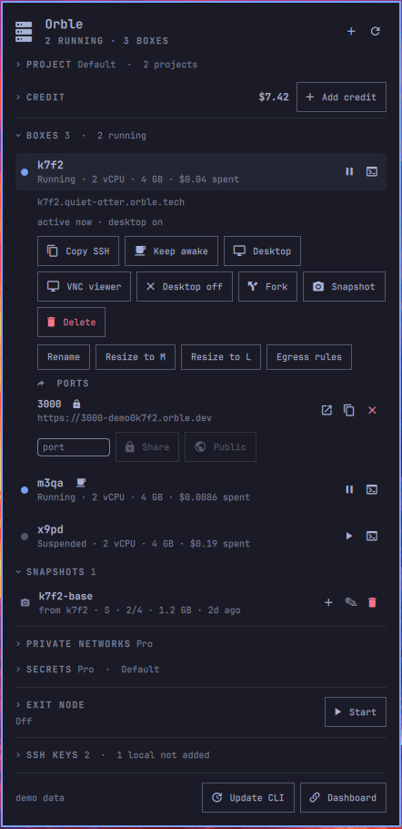

# Orble Helper

An [Omarchy](https://omarchy.org/) bar plugin for [Orble](https://orble.tech), sandboxes for AI agents. It puts your boxes, snapshots, credit, SSH keys and the exit node in a panel on the bar, using the official [CLI](https://orble.tech/docs?tab=cli): new boxes, forks, snapshots and boxes made from them, shared ports, one-click SSH, suspend and resume, the desktop in your browser or a VNC viewer, the exit node with its LAN and fallback options, SSH keys, top-ups, sign-in and CLI updates. With Orble Pro, it also manages outbound rules, private box networks and secret assignments.

It is a front end to the official `orble` CLI and uses the CLI's own sign-in. The plugin stores no token or password.



*The panel with **Demo data** on (made-up boxes, snapshots, keys and credit): one box expanded with its snapshot row and a shared port, and a snapshot offering the sizes for a new box.*

## What it does

**Bar icon.** A server icon that lights up while any box is running, with the count beside it, and a globe while the exit node is on. It is highlighted when you're signed out or your credit is low. Left-click opens the panel and right-click refreshes.

**Credit.** Your credit, account and box hostname pattern (`<box>.<account>.orble.tech`). **Add credit** offers $10, $25, $50 or $100; after you confirm, `orble topup <amount>` runs in a terminal, where you finish paying the way the CLI asks. The plugin never pays anything itself.

**New box (+).** Pick a size (S 2 vCPU / 4 GiB, M 4/8, L 8/16; $0.015, $0.03 or $0.06 an hour while running, nothing while suspended), optionally type a name, then **Create S/M/L box**: runs `orble new -s <size>`. To wake an existing box, use ▶ on its row. The notification names the box and how fast it started. With no credit, the panel refuses rather than letting `orble new` prompt for a top-up in the background.

**Boxes.** Every box shows its state, size and spend, with two buttons:

| Button | What happens |
|---|---|
| Terminal (SSH) | Opens a terminal with `orble ssh <box>`; a suspended box resumes on connect. |
| Play / pause | `orble suspend` a running box (processes are kept) or `orble resume` it. |

Click a box for its hostname, when it was last active, whether its desktop is on, and:

| Action | CLI | Asks first? |
|---|---|---|
| Keep awake / Let it sleep | `orble keep-awake <box>` / `orble keep-awake <box> off` (see below) | No |
| Copy SSH | copies `orble ssh <box>` (boxes are IPv6-only, so a plain `ssh <host>` fails on IPv4-only networks) | No |
| Desktop | `orble vnc <box>`: the desktop in your browser, started if needed | No |
| VNC viewer | `orble desktop <box>` in a terminal (shown only when `xtigervncviewer` or `remmina` is installed) | No |
| Desktop off | `orble desktop <box> --off` (shown while the desktop runs) | No |
| Rename | Set a display name while keeping the generated box identity for SSH and actions. | No |
| Resize | Restart the box at a larger size. Files stay and running programs stop. | Yes |
| Fork | `orble fork <box> -n 1` (a new box carrying on from this one, running programs included; forks are listed indented under their box) | Yes |
| Snapshot | `orble snapshot <box> [name]`: type an optional name, then **Save** (storage only, $0.05 per GiB-month) | No |
| Delete | `orble rm <box> -y` | Yes |

**Ports.** An expanded box also lists its shared ports (`orble port <box>`), each at its own HTTPS address, with buttons to open it, copy the address, make a public port private again, or stop sharing (`orble port <box> <port> --off`). Type a port and choose **Share** (`orble port <box> <port>`: only your signed-in Orble account can open it) or **Public** (`--public`: anyone with the address, asks first; Orble allows it only on accounts that have added credit). Ports load when you expand a box, since the CLI lists them one box at a time.

**Snapshots.** A list of your snapshots, always shown under the boxes (`orble snapshots --json`): name, the box it was saved from, its size, disk and age. **+** offers the sizes a box made from it can have and runs `orble new --from <snapshot> -s <size>`. At the snapshot's own size the new box has its files and running programs; larger, its files only (the tooltip says which). Gallery snapshots can be used to create boxes. Rename and delete are available for your own snapshots. The trash button deletes a snapshot (`orble snapshot rm <snapshot> -y`, asks first). Like `new`, making a box from a snapshot is refused at zero credit. The section is hidden with a CLI from before snapshots; **Update CLI** fixes that.

**Egress rules (Pro).** Open a box and choose **Egress rules**. Add or remove allow and deny rules for domains, wildcard domains, IPv4 addresses, or CIDRs. **Allowlist only** blocks everything else. **Clear rules and reopen** removes the policy. Rules carry over to forks and snapshots. Orble does not combine an exit node with egress rules.

**Private networks (Pro).** Open **Private networks** to see each network, its members, and their internal hostnames and addresses. Create a network and pick boxes to join. Remove members or delete a network after reviewing who will be disconnected. Forks inherit membership and connecting to a suspended member can wake it.

**Managed secrets (Pro).** Open **Secrets** to see names, destination hosts, and assigned boxes. Pick one or more boxes per secret or explicitly choose **All boxes**. Orble's own terminal prompt reads the value with echo disabled. Use **Replace value or scope** to submit a new value with the complete desired scope, then reopen the panel or choose **Refresh**. Verify the HTTP header and format when replacing a secret with custom settings. HTTPS interception is optional and installs the account CA in affected boxes. The panel only receives metadata.

**Keep awake.** Orble suspends a box about a minute after its last SSH connection closes, and processes running in it (an agent in tmux, a cron job) freeze until something connects again. **Keep awake** pins the box awake on Orble's side (`orble keep-awake <box>`), so it keeps running while this machine sleeps or is off, and resumes it if it was suspended. A pinned box shows a coffee cup and bills while it runs. **Let it sleep** (`orble keep-awake <box> off`) lets it suspend when idle again. Suspending a pinned box from the panel still suspends it, and the pin stays. The button needs an Orble CLI from 2026-11-19 or later; **Update CLI** gets one.

**Exit node.** Sends boxes' traffic through this machine, from its IP, while it runs (`orble exit-node`). Pick boxes (none picked means the ones switched on in the Orble dashboard), and optionally **LAN** (`--lan`: boxes reach your LAN, VPN or tailnet) and **Fallback** (`--fallback`: boxes use Orble's network while this machine is offline). **Stop** sends Ctrl-C (SIGINT) so the CLI puts the boxes back on Orble's network. The exit node runs as long as the shell does; restarting the shell or logging out stops it.

**SSH keys.** The keys on your account, each removable (`orble keys rm <fingerprint>`, asks first), and the `.pub` files in `~/.ssh` that aren't on the account yet, each with **+** to add it (`orble keys add <file>`).

Build a snapshot from a Dockerfile with `orble snapshot build` in a terminal, where you can select the build context and see progress.

**Footer.** When the list was refreshed, **Update CLI** (`orble update`) and **Dashboard**.

Every background action sends a notification when it finishes, saying whether it worked and, if not, what the CLI said.

## Requirements

- Omarchy with the Quickshell-based shell.
- The [`orble` CLI](https://orble.tech/docs), signed in (`orble account`). The new management controls were verified with `bc07c8bf`. Use **Update CLI** to enable them on an older CLI.
- `python3`, `ssh-keygen`, `wl-copy` and `xdg-open`, which Omarchy ships. Optional: `tigervnc` or `remmina` for the VNC viewer button.

## Install

```bash
omarchy plugin add https://github.com/thelaggingway/Orble-Helper.git --enable
omarchy restart shell
```

If you're signed out, the panel shows **Sign in to Orble**, which runs `orble login` in a terminal.

## Settings

| Key | Default | Meaning |
|---|---|---|
| `refreshIntervalSec` | `120` | How often to check while the panel is closed; every 10 s while it is open or an action runs. |
| `showCount` | `true` | Show the number of running boxes next to the icon. |
| `showCredit` | `true` | Show the credit card. |
| `lowCreditUSD` | `1` | Below this the credit turns red and the icon is highlighted; `0` turns it off. |
| `demoMode` | `false` | Made-up boxes, keys and credit for screenshots. The CLI is never called and actions do nothing. |

```bash
omarchy bar set thelaggingway.orble-helper refreshIntervalSec 300
omarchy bar set thelaggingway.orble-helper demoMode true --json
```

## Keyboard and scripting

```bash
omarchy-shell thelaggingway.orble-helper toggle     # also open, close, refresh
omarchy-shell thelaggingway.orble-helper newBox     # orble new (default size)
omarchy-shell thelaggingway.orble-helper exitNode   # start or stop the exit node
```

The helper works on its own too:

```bash
H=~/.config/omarchy/plugins/thelaggingway.orble-helper/bin/orble-panel
$H status | jq .
$H action suspend <box>
$H ports <box> | jq .
$H action snapshot <box> [name]
$H action new-from <snapshot> [s|m|l]
$H action port <box> <port>
$H exit-node --lan <box>
```

## How it works

```
Panel.qml ──argv──▶ bin/orble-panel ──argv──▶ orble CLI ──HTTPS──▶ orble.tech
```

- **`bin/orble-panel`** (Python, standard library) is the only code that runs `orble`. `status` runs `ls --json`, `snapshots --json`, `account` and `keys` in parallel; the last two have no JSON, so their text is parsed (and `ls` falls back to its table on an older CLI). `ports <box>` parses `orble port <box>`.
- **`Panel.qml`** draws everything, polls `status`, runs actions as child processes, opens terminals for SSH, the VNC viewer, top-ups and sign-in, and owns the exit-node process.
- **`Model.js`** holds the pure formatting logic, tested under Node.

### Security and privacy

- **No secret values in the plugin.** Signed out, every `orble` command starts a browser sign-in, so the background poll must not run one. The helper checks only *whether* `~/.config/orble/config.json` has a token, never reading it out, and reports "Not signed in" without calling the CLI. If the CLI starts a sign-in anyway (an expired token), the call is ended at once.
- **No shell strings, strict input.** Every process gets a fixed argument list. Box and snapshot names must match `^[A-Za-z0-9][A-Za-z0-9._-]{0,62}$`, ports 1 to 65535, fingerprints `SHA256:` plus 43 base64 characters, key files must be `.pub` files directly in `~/.ssh` (links resolved), and top-ups whole dollars from 10 to 500. Nothing can become a flag (the CLI itself would happily try to delete a box named `--help`).
- **No prompts in the background.** The CLI gets empty stdin, `rm` and `snapshot rm` always get `-y` (without it, `snapshot rm` reads the empty stdin as no, keeps the snapshot and still exits 0), `keys add` always gets a file, and `new`, `new --from` and `fork` are refused at zero credit.
- **Asks first:** deleting a box or snapshot, forking, key removal, public ports and top-ups. Top-ups only ever run in a visible terminal.
- **Plain text only**, for names and CLI output.
- **Network use:** only what the `orble` CLI does. The core refresh makes 4 account requests every 2 minutes in the background (plus one for the expanded box's ports when the panel opens), every 10 s while the panel is open, plus the actions you click. Network, secret and egress lists load on demand. The CLI help check is local. No cache or state files.

## Troubleshooting

| Symptom | Fix |
|---|---|
| No icon after installing | `omarchy restart shell`, or `omarchy bar put thelaggingway.orble-helper`. |
| "Not signed in" | **Sign in to Orble**, or `orble login`. |
| "Can't reach Orble" | The error is the CLI's; try `orble ls`. |
| A box shows odd fields | The CLI's table layout changed. Compare `orble ls` with `bin/orble-panel status`. |
| No VNC viewer button | Install `tigervnc` or `remmina`, or use **Desktop** (browser). |
| Shell log | `journalctl --user -f -o cat \| grep -i orble` |

## Update and uninstall

```bash
omarchy plugin update thelaggingway.orble-helper && omarchy restart shell
omarchy plugin remove thelaggingway.orble-helper
```

Removing the plugin stops the exit node if it is running (it lives in the shell). The `orble` CLI, its sign-in and your boxes are untouched; remove those with the CLI (`orble rm <box>`) or the Orble dashboard.

## Development

```bash
tests/run.sh    # static checks, the helper against a fake orble CLI, Model.js under Node
```

See [AGENTS.md](AGENTS.md). MIT licensed; Orble is a separate service and this plugin is not affiliated with it.
